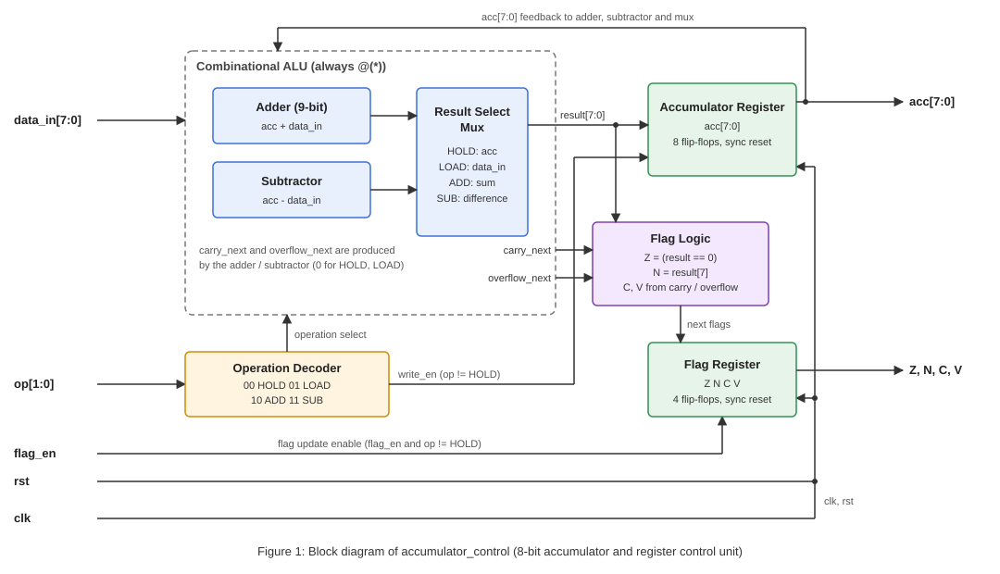
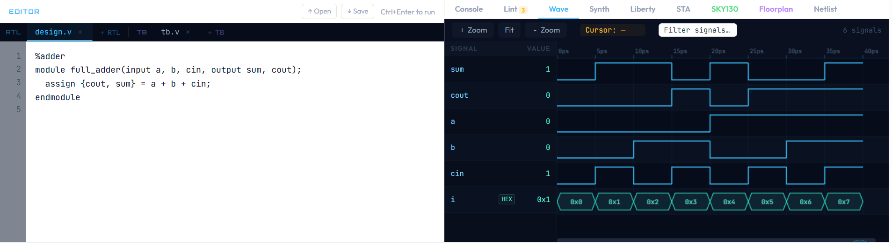
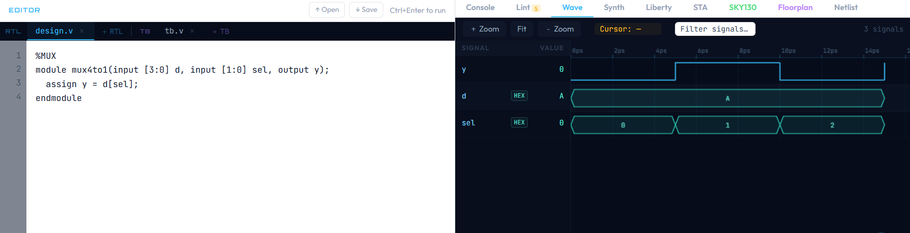
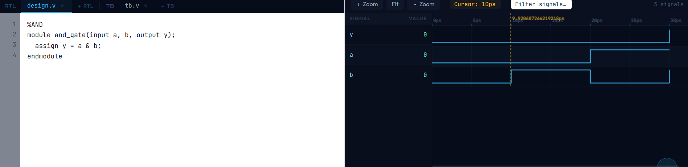
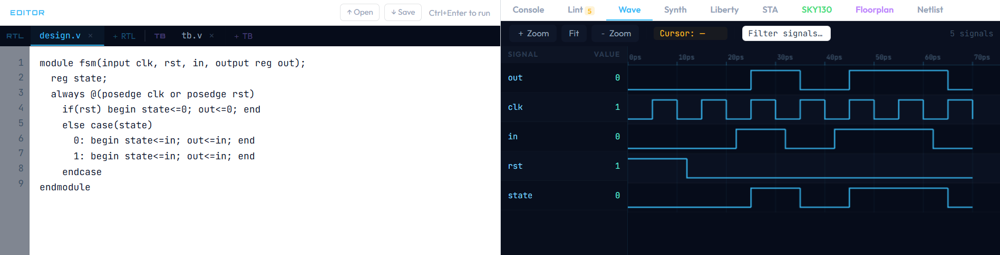

# Synchronous-Accumulator-and-Register-Control-Unit-with-Selective-Status-Flag-Updates
Synchronous Accumulator and Register Control Unit with Selective Status Flag Updates
# 8-Bit Accumulator and Register Control Unit using Verilog HDL

## 1. Project Overview

This project implements an **8-bit Accumulator and Register Control Unit** using Verilog Hardware Description Language (HDL).



*Figure 1: Block diagram of accumulator_control.*

An accumulator is a special-purpose register used in digital systems and processors to store intermediate results of arithmetic and logical operations. It plays an important role in the Arithmetic Logic Unit (ALU) of a processor.

The designed circuit performs four basic operations:

- **HOLD:** Retains the previous accumulator value.
- **LOAD:** Loads new input data into the accumulator.
- **ADD:** Adds the input data to the current accumulator value.
- **SUB:** Subtracts the input data from the current accumulator value.

In addition to performing these operations, the circuit generates four status flags:

- Zero Flag (Z)
- Negative Flag (N)
- Carry Flag (C)
- Overflow Flag (V)

The project also includes a Verilog testbench containing **24 directed test cases** to verify the functionality of the accumulator, arithmetic operations, reset mechanism, and status flag generation.

The design uses an 8-bit data path and operates synchronously with a clock signal.

---

## 2. Objectives

The main objectives of this project are:

1. To design an 8-bit accumulator using Verilog HDL.
2. To implement basic arithmetic operations such as addition and subtraction.
3. To implement LOAD and HOLD operations for register control.
4. To understand the working of synchronous active-high reset.
5. To generate and verify Zero, Negative, Carry, and Overflow flags.
6. To implement flag enable control for selectively updating status flags.
7. To verify the complete design using a Verilog testbench.
8. To test normal operations as well as boundary conditions and arithmetic overflow cases.

---

## 3. Design Specifications

| Parameter | Description |
|---|---|
| Design Name | Accumulator and Register Control Unit |
| Hardware Description Language | Verilog HDL |
| Data Width | 8 bits |
| Accumulator Width | 8 bits |
| Operation Code Width | 2 bits |
| Clock | Positive-edge triggered |
| Reset | Synchronous, active-high |
| Number of Operations | 4 |
| Status Flags | 4 |
| Test Cases | 24 directed tests |

---

## 4. Block-Level Description

The accumulator control unit consists of the following main components:

### 4.1 Input Section

The circuit receives the following inputs:

| Input | Width | Description |
|---|---:|---|
| clk | 1 bit | Clock signal that controls sequential operation. |
| rst | 1 bit | Active-high synchronous reset signal. |
| flag_en | 1 bit | Enables or disables status flag updates. |
| op | 2 bits | Selects the operation to be performed. |
| data_in | 8 bits | 8-bit input data used for loading or arithmetic operations. |

### 4.2 Accumulator Register

The accumulator is an 8-bit register that stores the result of the selected operation.

Depending on the operation code, it can:

- Retain its previous value.
- Store new input data.
- Store the result of addition.
- Store the result of subtraction.

The accumulator updates only at the positive edge of the clock.

### 4.3 Arithmetic and Control Section

This section determines which operation must be performed based on the 2-bit operation code.

It performs the selected operation and calculates the corresponding arithmetic flags.

### 4.4 Status Flag Section

The circuit generates four status flags that provide information about the arithmetic result.

These flags help identify conditions such as zero results, negative results, unsigned carry or borrow, and signed arithmetic overflow.

---

## 5. Operation Codes

The circuit uses a 2-bit operation code (`op`) to select one of four operations.

| Operation | Opcode | Function |
|---|---|---|
| HOLD | 00 | Retains the previous accumulator value. |
| LOAD | 01 | Loads `data_in` into the accumulator. |
| ADD | 10 | Adds `data_in` to the accumulator. |
| SUB | 11 | Subtracts `data_in` from the accumulator. |

### 5.1 HOLD Operation (00)

In HOLD mode, the accumulator retains its previous value.

**Example:**

If the accumulator contains `8'hFF` and the operation is HOLD, the accumulator remains `8'hFF`, regardless of the input data.

The status flags also remain unchanged.

### 5.2 LOAD Operation (01)

In LOAD mode, the input data is directly transferred into the accumulator.

**Example:**

```verilog
acc = 8'h25;
```

If `data_in = 8'h7A`, the new accumulator value becomes:

```verilog
acc = 8'h7A;
```

When flag updates are enabled, the flags are updated according to the loaded value. Carry and Overflow are cleared for this operation.

### 5.3 ADD Operation (10)

In ADD mode, the input data is added to the current accumulator value.

**Example:**

```text
ACC     = 00000101 (5)
DATA_IN = 00000011 (3)

RESULT  = 00001000 (8)
```

The result is stored in the accumulator.

The design uses a 9-bit intermediate result to detect an unsigned carry generated during addition.

It also checks for signed overflow.

### 5.4 SUB Operation (11)

In SUB mode, the input data is subtracted from the accumulator.

**Example:**

```text
ACC     = 00001000 (8)
DATA_IN = 00000011 (3)

RESULT  = 00000101 (5)
```

The result is stored in the accumulator.

The design also checks whether an unsigned borrow occurs and whether signed overflow takes place.

For subtraction, the Carry flag is set when no unsigned borrow occurs.

---

## 6. Status Flags

The circuit generates four status flags: Z, N, C, and V.

These flags are updated only when `flag_en = 1` during an operation other than HOLD.

### 6.1 Zero Flag (Z)

The Zero flag indicates whether the result of an operation is zero.

- Z = 1: Result is zero.
- Z = 0: Result is non-zero.

**Example:**

```text
ACC     = 00000101
DATA_IN = 00000101

SUB     = 00000000

Z = 1
```

### 6.2 Negative Flag (N)

The Negative flag indicates the sign bit of the 8-bit result when interpreted as a signed two's-complement number.

- N = 1: Most significant bit is 1.
- N = 0: Most significant bit is 0.

**Example:**

```text
RESULT = 11111111

N = 1
```

### 6.3 Carry Flag (C)

The Carry flag indicates an unsigned carry during addition or the absence of an unsigned borrow during subtraction.

For addition:
- C = 1: An unsigned carry is generated.
- C = 0: No unsigned carry is generated.

For subtraction:
- C = 1: No unsigned borrow occurs.
- C = 0: An unsigned borrow occurs.

**Example of Addition:**

```text
ACC     = 11111111
DATA_IN = 00000001

RESULT  = 00000000

C = 1
```

### 6.4 Overflow Flag (V)

The Overflow flag indicates whether a signed arithmetic operation produces a result outside the representable range of an 8-bit signed number.

The signed 8-bit range is:

```text
-128 to +127
```

For addition, overflow occurs when two operands with the same sign produce a result with the opposite sign.

For subtraction, overflow occurs when operands with different signs produce a result whose sign differs from the accumulator's sign.

**Example:**

```text
ACC     = 01111111  (+127)
DATA_IN = 00000001  (+1)

RESULT  = 10000000  (-128)

V = 1
```

This indicates positive signed overflow.

### 6.5 Flag Summary

| Flag | Name | Meaning |
|---|---|---|
| Z | Zero | Indicates whether the result is zero. |
| N | Negative | Indicates the most significant bit of the result. |
| C | Carry | Indicates unsigned carry or absence of borrow. |
| V | Overflow | Indicates signed arithmetic overflow. |

**Important:** The flag order used in the testbench is:

```verilog
{Z, N, C, V}
```

---

## 7. Working Principle of the Design


The design is divided into two main procedural blocks.

### 7.1 Combinational Logic

The first block uses:

```verilog
always @(*)
```

This block calculates the next accumulator result and the corresponding carry and overflow conditions.

It uses a `case` statement to select the operation based on the opcode.

The default values are initialized before the case statement to ensure that the combinational logic has defined outputs for every operation.

The calculated result is then used by the sequential block.

### 7.2 Sequential Logic

The second block uses:

```verilog
always @(posedge clk)
```

This block controls the actual updating of the accumulator and status flags.

Its working sequence is:

1. At the positive edge of the clock, the circuit checks the reset signal.
2. If reset is HIGH, the accumulator is cleared and the status flags are initialized.
3. If reset is LOW and the operation is not HOLD, the accumulator is updated with the calculated result.
4. If `flag_en` is HIGH, the status flags are updated.
5. If `flag_en` is LOW, the accumulator can still update, but the previous status flags are retained.
6. If the operation is HOLD, both the accumulator and flags retain their previous values.

### 7.3 Reset Condition

The circuit uses a synchronous active-high reset.

When `rst = 1`, the following values are assigned:

```verilog
acc = 8'h00;
Z   = 1'b1;
N   = 1'b0;
C   = 1'b0;
V   = 1'b0;
```

The reset is checked at the positive edge of the clock.

---

## 8. Flag Enable Control

One important feature of this design is the `flag_en` input.

It provides independent control over status flag updates.

| flag_en | Accumulator | Status Flags |
|---|---|---|
| 0 | Updates according to the selected operation. | Retain previous values. |
| 1 | Updates according to the selected operation. | Update according to the result. |

For example, consider the following operation:

```text
ACC     = 8'h00
DATA_IN = 8'h01
OP      = ADD
flag_en = 0
```

The accumulator becomes:

```text
ACC = 8'h01
```

However, the status flags retain their previous values.

This feature allows the accumulator to perform operations without necessarily changing the existing status information.

---

## 9. Testbench Description

The project includes a separate testbench module:

```verilog
module tb_accumulator_control;
```

The testbench verifies the functionality of the accumulator control unit through 24 directed test cases.

It instantiates the main design as a Device Under Test (DUT).

### 9.1 Clock Generation

The testbench generates a clock signal with a period of 10 ns.

```verilog
initial clk = 1'b0;
always #5 clk = ~clk;
```

The clock changes its state every 5 ns.

### 9.2 Drive Task

The `drive` task applies the required input signals before the active clock edge.

It controls:

- Reset signal.
- Operation code.
- Input data.
- Flag enable signal.

### 9.3 Check Task

The `check` task compares the actual accumulator value and status flags with their expected values.

It checks:

```verilog
acc
{Z, N, C, V}
```

The case equality operator (`!==`) is used to detect mismatches, including unknown or high-impedance values.

If the actual result matches the expected result, the test is displayed as PASS.

Otherwise, it is displayed as FAIL, and the error counter is incremented.

### 9.4 Test Categories

The 24 test cases are organized into five categories.

| Category | Test Numbers | Purpose |
|---|---|---|
| Reset | 1–2 | Verify reset initialization and reset priority. |
| LOAD | 3–7 | Verify loading of different 8-bit values. |
| HOLD | 8 | Verify that the accumulator and flags remain unchanged. |
| Addition | 9–14 | Verify normal addition, carry, zero, and signed overflow. |
| Subtraction | 15–20 | Verify normal subtraction, borrow, zero, and signed overflow. |
| Flag Enable | 21–24 | Verify flag retention and re-enabling of flag updates. |

### 9.5 Important Test Cases

Some important test cases included in the testbench are:

| Test | Operation | Expected Result | Purpose |
|---|---|---|---|
| 05 + 03 | ADD | 08 | Normal addition. |
| FF + 02 | ADD | 01 | Unsigned carry. |
| 7F + 01 | ADD | 80 | Positive signed overflow. |
| FF + 01 | ADD | 00 | Zero result with carry. |
| 08 - 03 | SUB | 05 | Normal subtraction. |
| 05 - 05 | SUB | 00 | Zero result. |
| 00 - 01 | SUB | FF | Unsigned borrow. |
| 7F - FF | SUB | 80 | Positive signed overflow. |
| 80 - 01 | SUB | 7F | Negative signed overflow. |

All values in this table are represented in hexadecimal notation.

---

## 10. Simulation and Execution

The Verilog source contains both the design module and its testbench.

You can simulate the project using a Verilog simulator such as:

- ModelSim / QuestaSim
- Icarus Verilog
- Xilinx Vivado Simulator

### Results


*Figure 2: Full adder.*

*Figure 3: MUX .*

*Figure 4: Bitwise AND operation.*

*Figure 5: FSM.*

### Using Icarus Verilog

**Step 1: Save the source file**

Save the Verilog code with the following filename:

```text
accumulator_control.v
```

**Step 2: Compile the design**

Open a terminal in the directory containing the source file and execute:

```bash
iverilog -g2012 -o simulation accumulator_control.v
```

**Step 3: Run the simulation**

```bash
vvp simulation
```

**Step 4: Observe the output**

The terminal displays the result of each test case.

Successful test cases are displayed as:

```text
PASS 1: Reset at startup
PASS 2: Reset overrides ADD and flag disable
```

The testbench also displays the actual and expected values if a test fails.

At the end of the simulation, a summary is displayed containing:

- Total number of tests executed.
- Number of errors.
- Overall simulation result.

The expected final message for a successful simulation is:

```text
Tests executed: 24
Errors:         0
RESULT: ALL TESTS PASSED
```

---

## 11. Expected Results

The design is expected to perform all four operations correctly.

The testbench verifies:

- Correct initialization of the accumulator during reset.
- Correct loading of input data.
- Retention of accumulator values during HOLD.
- Correct addition and subtraction results.
- Proper detection of unsigned carry and borrow.
- Correct detection of signed overflow.
- Proper generation of Zero and Negative flags.
- Correct flag retention when flag enable is disabled.
- Correct flag updates when flag enable is re-enabled.

A successful simulation should complete all 24 directed tests without errors.

---

## 12. Key Concepts Learned

Through this project, the following digital design concepts can be understood:

1. **Verilog HDL:** Implementation of digital hardware using Verilog.
2. **Combinational Logic:** Calculation of arithmetic results using combinational procedural blocks.
3. **Sequential Logic:** Updating register values using a positive-edge-triggered clock.
4. **Accumulator:** Storage of intermediate arithmetic results.
5. **Arithmetic Operations:** Implementation of 8-bit addition and subtraction.
6. **Status Flags:** Detection of zero, negative, carry, and overflow conditions.
7. **Synchronous Reset:** Initialization of sequential circuit elements using a clock.
8. **Enable Control:** Independent control of status flag updates.
9. **Testbench Design:** Verification of hardware functionality using directed test cases.
10. **Simulation and Debugging:** Comparing expected and actual outputs to identify design errors.

---

## 13. Conclusion

This project successfully implements an 8-bit Accumulator and Register Control Unit using Verilog HDL.

The design performs four basic operations: HOLD, LOAD, ADD, and SUB. It also generates four important status flags: Zero, Negative, Carry, and Overflow.

A synchronous active-high reset is implemented to initialize the accumulator and status flags. Additionally, a flag enable control mechanism allows status flags to retain their previous values while the accumulator continues to perform arithmetic operations.

The design is verified using a testbench containing 24 directed test cases covering normal operations, boundary conditions, carry generation, unsigned borrow, signed overflow, reset behavior, and flag enable functionality.

This project provides practical experience in combinational logic, sequential logic, arithmetic circuit design, register control, and functional verification using Verilog HDL.

---

## 14. Repository Structure

```text
Accumulator-Control-Unit/
│
├── accumulator_control.v
│   └── Verilog design and testbench
│
└── README.md
    └── Project documentation
```

---

## 15. Author

**Project:** 8-Bit Accumulator and Register Control Unit

**Language:** Verilog HDL

**Project Area:** Digital System Design and Hardware Description Languages

**Verification:** 24 Directed Test Cases

---

## 16. Keywords

Verilog HDL, Accumulator, Register Control Unit, Digital Design, Arithmetic Logic Unit, ALU, 8-Bit Arithmetic, Status Flags, Carry Flag, Overflow Flag, Synchronous Reset, Testbench, Hardware Verification.
